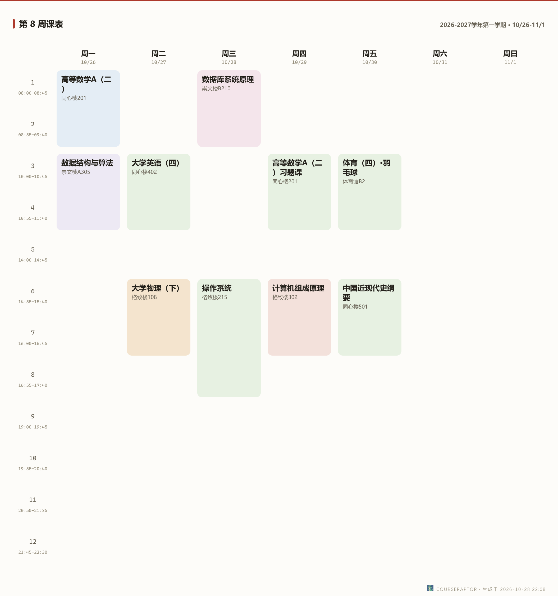

# export-schedule

<p align="center">
  
</p>

<p align="center">
  <a href="https://github.com/Health-525/export-schedule-skill/releases"></a>
  <a href="./LICENSE"></a>
</p>

> 把课表渲染成图片文件：第 N 周课表或整学期汇总，PNG/SVG，零登录零网络，本地缓存直出。

[CourseRaptor](https://github.com/Health-525/courseraptor)「课表图片导出」技能的独立发布仓库。

<p align="center">
  
  <br><sub>classic · 红头档案（CourseRaptor 招牌风格，示例数据）</sub>
</p>
<p align="center">
  
  <br><sub>color · 彩色课格（示例数据）</sub>
</p>

## 背景

[CourseRaptor](https://github.com/Health-525/courseraptor) 网页端有「本周图片 / 整学期图片」按钮；本仓库把**同一套渲染器**打成单文件脚本（`scripts/export.mjs`），不需要安装完整项目，克隆即用。既能命令行直接出图，也能作为 agent 技能装进对话工具，说一句「导出课表」就出图。

版本随主项目打包发布；对话式 agent、待办、知识库等完整能力请移步主仓库 [CourseRaptor](https://github.com/Health-525/courseraptor)。

## 特性

- 🖼️ 两种风格：classic 红头档案 / color 彩色课格
- 📅 两种粒度：第 N 周课表 / 整学期汇总
- 🖨️ 两种格式：PNG（2 倍宽高清）/ SVG（矢量）
- 🔒 零登录零网络：只读本地课表缓存，不碰教务系统
- 🤖 双形态：命令行直用，或作为 Agent Skills 装进对话工具
- 📦 克隆即用：无需 `npm install`（Windows x64 的 PNG 原生模块随仓库携带）

## 安装

> 前置要求：[Node.js](https://nodejs.org/) ≥ 18（`node --version` 可验证）；一份自己的课表缓存（见下方「首次配置」）。

```bash
git clone https://github.com/Health-525/export-schedule-skill.git
cd export-schedule-skill
node scripts/export.mjs            # 本周课表 PNG
```

不想用 git？从 [Releases](https://github.com/Health-525/export-schedule-skill/releases) 下载 zip 解压，用法相同。

### 作为 agent 技能安装

把仓库整个文件夹（建议目录名保持 `export-schedule`）放进所用工具的技能目录：

| 工具 | 技能目录 |
| --- | --- |
| Claude Code | `~/.claude/skills/`（或项目内 `.claude/skills/`） |
| ZCode | `~/.zcode/skills/`（或项目内 `.zcode/skills/`） |
| WorkBuddy | `~/.workbuddy/skills/` |
| 其他支持 Agent Skills 规范的工具 | 多数认 `~/.agents/skills/`，详见各工具文档 |

放好后无需重启配置，对话里说「导出课表」即可触发。

### 首次配置：准备课表缓存

脚本只读本地缓存 `schedule-cache.json`（你自己的课表数据），三选一：

- **拷贝**：从本机 [CourseRaptor](https://github.com/Health-525/courseraptor) 完整版的 `data/` 目录拷到本仓库 `data/` 下（没有就新建）；
- **指定**：调用时加 `--cache <路径>` 指向那份文件；
- **还没有**：先在 CourseRaptor 里查询一次课表（缓存自动落盘），再回来拷贝。

## 用法

```bash
node scripts/export.mjs                                # 本周课表 PNG（红头档案）
node scripts/export.mjs --week 8 --style color         # 第 8 周 · 彩色课格
node scripts/export.mjs --mode term                    # 整学期汇总 PNG
node scripts/export.mjs --mode term --format svg       # 整学期 SVG（矢量）
node scripts/export.mjs --out D:/课表                  # 指定输出目录
node scripts/export.mjs --open                         # 导出后用默认浏览器打开
```

`node scripts/export.mjs --help` 完整选项（真实输出）：

```
课表图片导出：从本地课表缓存渲染 PNG/SVG（零登录零网络）

用法: node export.mjs [--mode week|term] [--week N] [--style classic|color]
                     [--format png|svg] [--out <目录|文件名>] [--cache <schedule-cache.json>]
                     [--open | --serve [--port N] [--idle-min M]]

  --mode    week=第 N 周课表（默认）；term=整学期汇总
  --week    周次（week 模式；缺省取当前教学周）
  --style   classic=红头档案（默认）；color=彩色课格
  --format  png=2 倍宽位图（默认）；svg=矢量
  --out     输出位置（目录或文件名；缺省当前目录）
  --cache   直接指定 schedule-cache.json（缺省读技能 data/ 下的缓存）
  --open    导出后用默认浏览器打开预览（默认只导出，不弹窗）
  --serve   导出后挂本地预览服务（127.0.0.1），供聊天对话框内嵌显示
  --port    预览端口（默认 8917；被占用时自动向后找可用端口）
  --idle-min 预览服务空闲自动退出的分钟数（默认 30；0=不自动退出）
```

### 在对话工具里内嵌显示

聊天客户端普遍不渲染 `file://` 本地图——`--serve` 导出后把输出目录挂到 `http://127.0.0.1:<端口>/`（只绑本机回环，空闲 30 分钟自动退出），agent 技能就靠它把课表图直接显示在对话里。

<details>
<summary>排障</summary>

**报「还没有课表缓存」**：见上文「首次配置」，不要凭空编造课表内容。

**报「周次越界」/「当前不在教学周内」**：加 `--week N` 指定周次（报错信息里带有效范围 `1-N`）；假期期间缺省周次不可用。

**PNG 平台说明**：

- Windows x64：开箱即用（仓库已带原生渲染模块）。
- macOS / Linux：PNG 需要原生模块，仓库只带 Windows 版；默认会**自动降级输出 SVG**（浏览器直接打开，效果相同）。想要 PNG：在本目录执行 `npm install @resvg/resvg-js`（自动安装对应平台二进制）后重试。
- PNG 用系统字体渲染中文：Windows / macOS 开箱即用；极简 Linux 需自装一款中文字体。

**导出图没有「今天」标记**：刻意设计——静态图片上的「今天」只在导出当天成立，隔天再看反而误导。

**配置文件**：仓库根目录可放 `.env`（参考 [`.env.example`](./.env.example)）：`RAPTOR_DATA_DIR` 指定缓存目录（默认本仓库 `data/`）。

</details>

## 贡献

本仓库内容由主仓库 [CourseRaptor](https://github.com/Health-525/courseraptor) 的 `skills/export-schedule` 经打包管线（`npm run package:skill`）生成——问题与改进请到主仓库提 issue / PR。

## 许可证

[MIT](./LICENSE) © 2026 jiangshu
